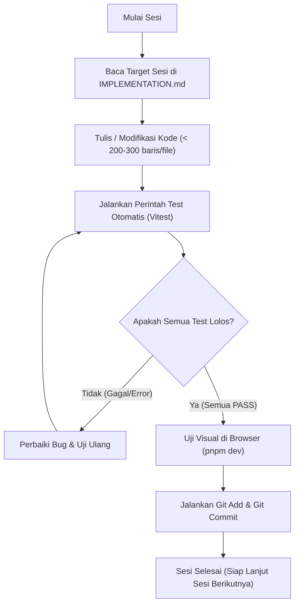

# PANDUAN IMPLEMENTASI SISTEM: DESKTOP PHOTO TEXT EDITOR (MVP)

> **Untuk:** Junior Developer & Tim Pengembang  
> **Status:** Siap Dikerjakan (Ready for Implementation)  
> **Basis Dokumen:** [PRD.md](./PRD.md)  
> **Tech Stack Terpilih:** React 19 + TypeScript + Vite + Tailwind CSS + Konva.js (`react-konva`) + Vitest + Tauri 2 Shell

---

## 1. Aturan Emas Pengerjaan (Golden Rules)

Sebelum mulai menulis kode, pahami dan patuhi 4 aturan mutlak berikut:

1. **Batas Ukuran File (Maksimal 200–300 Baris):**
   - **Tidak boleh ada file kode (`.ts`, `.tsx`, `.css`) yang melebihi 300 baris!** Target ideal adalah 100–200 baris per file.
   - Jika suatu file mulai mendekati 250 baris, segera pecah:
     - Pisahkan logika perhitungan ke `src/utils/` atau custom hooks di `src/hooks/`.
     - Pisahkan sub-komponen UI ke file terpisah di direktori komponen terkait.
     - Pisahkan tipe data (`interface`, `type`) ke `src/types/`.
     - Pisahkan nilai konstan/preset ke `src/constants/`.

2. **Struktur Sesi Mandiri (1 Sesi = 1 Milestone Selesai):**
   - Setiap sesi pengerjaan dirancang untuk diselesaikan dalam **1 sesi kerja terpisah**.
   - Setiap sesi memiliki target fitur yang jelas, file yang dikerjakan, dan hasil yang langsung bisa diuji.

3. **Pengujian Sebelum Kommit (Test-Driven Mindset):**
   - Setiap sesi memiliki skrip pengujian otomatis (menggunakan Vitest) dan ceklis uji visual.
   - **Wajib menjalankan perintah pengujian sampai status PASS hijau** sebelum melakukan `git commit`.

4. **Kommit Otomatis & Terstruktur:**
   - Setelah pengujian lolos, lakukan commit dengan format pesan konvensional (`feat:`, `test:`, `refactor:`) sesuai instruksi di akhir setiap sesi.

---

## 2. Struktur Arsitektur & Folder Proyek

Untuk menjaga kode tetap bersih, rapi, dan di bawah batas 250 baris per file, berikut adalah cetak biru struktur folder proyek:

```text
photo-editor/
├── PRD.md
├── IMPLEMENTATION.md
├── index.html
├── package.json
├── tsconfig.json
├── vite.config.ts
├── vitest.config.ts
├── tailwind.config.js
├── postcss.config.js
├── src-tauri/                     # Shell Tauri 2 (Desktop Wrapper)
│   ├── Cargo.toml
│   ├── tauri.conf.json
│   └── src/main.rs
├── src/
│   ├── main.tsx                   # Entry point React (< 50 baris)
│   ├── App.tsx                    # Layout utama dashboard (< 150 baris)
│   ├── types/                     # Definisi tipe TypeScript
│   │   ├── photo.ts               # Interface PhotoItem, PhotoMetadata
│   │   ├── layer.ts               # Interface TextLayer, TextStyle
│   │   ├── export.ts              # Interface ExportConfig, ExportProgress
│   │   └── history.ts             # Interface HistoryState, ActionType
│   ├── constants/                 # Konstanta & Preset default
│   │   ├── fonts.ts               # Daftar font standar Windows
│   │   ├── defaultStyles.ts       # Gaya teks awal saat klik tambah teks
│   │   └── canvas.ts              # Ukuran default kanvas & batas zoom
│   ├── services/                  # Platform Adapter & Engine
│   │   ├── platformAdapter.ts     # Abstraksi dialog file (Web vs Tauri)
│   │   ├── fileReader.ts          # Utilitas baca file foto & blob
│   │   └── exportEngine.ts        # Render offscreen canvas resolusi penuh
│   ├── stores/                    # State Management (Zustand / Reactive Store)
│   │   ├── usePhotoStore.ts       # State daftar foto & foto aktif
│   │   ├── useLayerStore.ts       # State layer teks & layer aktif
│   │   └── useHistoryStore.ts     # State undo/redo stack (50 langkah)
│   ├── hooks/                     # Custom Hooks (Logika terpisah dari UI)
│   │   ├── useCanvasScale.ts      # Kalkulasi rasio foto ke ukuran layar
│   │   ├── useBatchProcess.ts     # Antrean pemrosesan ekspor banyak foto
│   │   └── useKeyboardShortcuts.ts# Shortcut keyboard (Ctrl+Z, Ctrl+Y, Del)
│   ├── utils/                     # Fungsi matematika & formatting murni
│   │   ├── scaleMath.ts           # Perhitungan koordinat relatif (%) & font
│   │   ├── colorUtils.ts          # Konversi Hex, RGB, dan Opacity
│   │   └── fileNaming.ts          # Generator nama file hasil ekspor
│   ├── components/
│   │   ├── layout/
│   │   │   ├── HeaderToolbar.tsx  # Toolbar atas (Buka, Tambah, Undo, Ekspor)
│   │   │   ├── LeftSidebar.tsx    # Panel navigasi/alat cepat
│   │   │   └── BottomThumbnails.tsx # Strip thumbnail foto batch di bawah
│   │   ├── canvas/
│   │   │   ├── CanvasViewport.tsx # Wrapper kanvas Konva utama
│   │   │   ├── CanvasImage.tsx    # Rendering foto latar belakang
│   │   │   ├── CanvasTextLayer.tsx# Rendering teks individual + styling
│   │   │   └── CanvasTransformer.tsx # Handle drag, resize, rotate
│   │   ├── properties/
│   │   │   ├── PropertiesPanel.tsx# Container panel properti kanan
│   │   │   ├── ContentProperty.tsx# Input teks isi & font family/size
│   │   │   ├── TypographyProperty.tsx # Bold, italic, text-align, opacity
│   │   │   ├── StrokeProperty.tsx # Pengaturan outline/stroke
│   │   │   ├── ShadowProperty.tsx # Pengaturan bayangan
│   │   │   ├── BackgroundProperty.tsx # Pengaturan background teks
│   │   │   └── LayerOrderList.tsx # Daftar layer (z-index, hide, delete)
│   │   └── dialogs/
│   │       ├── ExportSingleModal.tsx # Dialog ekspor 1 foto
│   │       ├── ExportBatchModal.tsx  # Dialog ekspor batch + progress bar
│   │       └── TemplateModal.tsx     # Dialog simpan/muat JSON template
│   └── tests/                     # File pengujian unit Vitest
│       ├── scaleMath.test.ts
│       ├── layerStore.test.ts
│       ├── photoStore.test.ts
│       ├── historyStore.test.ts
│       └── exportEngine.test.ts
```

---

## 3. Rencana Pengerjaan Per Sesi (Step-by-Step)

---

### Sesi 1: Setup Proyek, Tooling, Type Definitions, & Platform Adapter

#### 🎯 Target Sesi 1:
1. Inisialisasi Git repository dan struktur proyek React + Vite + TypeScript.
2. Konfigurasi Tailwind CSS untuk styling cepat dan modern.
3. Instalasi `konva`, `react-konva`, `zustand` (state management), `lucide-react` (ikon), dan `vitest` (testing).
4. Pembuatan kontrak tipe data TypeScript (`types/*.ts`) sesuai kebutuhan PRD.
5. Pembuatan `platformAdapter.ts` untuk abstraksi lingkungan Web dan Desktop Tauri (agar bisa diuji di browser secara instan).

#### 🛠️ Langkah Pengerjaan Rinci:
1. Inisialisasi Git jika belum ada:
   ```bash
   git init
   ```
2. Setup Vite dengan React TypeScript template:
   ```bash
   pnpm create vite . --template react-ts
   ```
   *(Pilih overwrite jika ditanya).*
3. Pasang dependensi inti:
   ```bash
   pnpm add konva react-konva zustand lucide-react clsx tailwind-merge
   pnpm add -D tailwindcss @tailwindcss/vite vitest @testing-library/react jsdom @types/node
   ```
4. Konfigurasi file konfigurasi dasar:
   - `vite.config.ts`: Konfigurasi plugin Vite & Tailwind.
   - `vitest.config.ts`: Konfigurasi test environment `jsdom`.
5. Buat file types di `src/types/`:
   - `src/types/photo.ts`: Interface `PhotoItem` (id, file, url, name, originalWidth, originalHeight).
   - `src/types/layer.ts`: Interface `TextLayer` & `TextStyle` (fontSize, fontFamily, fill, stroke, shadow, background, rotation, relativeX, relativeY, opacity, zIndex, visible).
   - `src/types/export.ts`: Interface `ExportConfig` (format 'png'|'jpg'|'webp', quality, namingPattern, outputDir).
6. Buat `src/services/platformAdapter.ts`:
   - Buat fungsi abstraksi: `openFileDialog()` dan `saveFileBlob()` dengan fallback ke standar Web File API (`<input type="file">` dan URL.createObjectURL).
7. Buat test pertama di `src/tests/platformAdapter.test.ts` untuk memverifikasi fungsionalitas parser nama file dan fallback adapter.

#### 🧪 Perintah Pengujian:
```bash
pnpm vitest run src/tests/platformAdapter.test.ts
```
*Pastikan: 100% tests PASS.*

#### 📦 Perintah Commit:
```bash
git add .
git commit -m "feat(setup): initialize project with vite, tailwind, types, and platform adapter"
```

---

### Sesi 2: Canvas Viewport & Manajemen Foto Tunggal

#### 🎯 Target Sesi 2:
1. State management foto aktif (`usePhotoStore.ts`) menggunakan Zustand.
2. Fitur Buka Foto tunggal (JPG, PNG, WebP) melalui tombol Buka Foto dan Drag & Drop ke layar (PRD F1).
3. Kanvas utama menggunakan Konva (`CanvasViewport.tsx` & `CanvasImage.tsx`).
4. Algoritma Responsive Fit: Foto otomatis diskalakan agar muat pas di layar tengah tanpa terpotong atau distorsi aspect ratio.

#### 🛠️ Langkah Pengerjaan Rinci:
1. Buat `src/stores/usePhotoStore.ts`:
   - State: `photos: PhotoItem[]`, `activePhotoId: string | null`.
   - Actions: `addPhoto(photo: PhotoItem)`, `setActivePhoto(id: string)`, `removePhoto(id: string)`.
   - Pastikan panjang file < 120 baris.
2. Buat `src/utils/scaleMath.ts`:
   - Fungsi `calculateFitScale(containerW, containerH, imageW, imageH)`: Menghasilkan scale factor, offset X, dan offset Y agar foto berada persis di tengah kanvas.
3. Buat `src/components/canvas/CanvasViewport.tsx`:
   - Menggunakan komponen `Stage` dan `Layer` dari `react-konva`.
   - Menghitung ukuran container kanvas secara otomatis dengan `ResizeObserver`.
4. Buat `src/components/canvas/CanvasImage.tsx`:
   - Komponen Konva `Image` yang memuat gambar foto latar belakang sesuai scale dan offset dari Sesi 2 langkah 2.
5. Buat fitur Drag-and-Drop file foto pada `App.tsx` atau wrapper layout.
6. Buat file test `src/tests/scaleMath.test.ts` untuk menguji perhitungan fit canvas dengan berbagai aspect ratio foto (portrait, landscape, square).

#### 🧪 Perintah Pengujian:
```bash
pnpm vitest run src/tests/scaleMath.test.ts
```
*Verifikasi Visual:* Jalankan `pnpm dev`, buka di browser, drag foto ke aplikasi, foto tampil pas di tengah layar kanvas.

#### 📦 Perintah Commit:
```bash
git add .
git commit -m "feat(canvas): implement photo loading, auto-fit viewport, and photo store"
```

---

### Sesi 3: Sistem Layer Teks & Interaksi Canvas (Konva Transformer)

#### 🎯 Target Sesi 3:
1. State management layer teks (`useLayerStore.ts`): Tambah, pilih, ubah posisi, dan hapus teks (PRD F4, F5).
2. Tampilkan teks di atas foto pada kanvas Konva (`CanvasTextLayer.tsx`).
3. Interaksi visual penuh: Klik teks untuk memilih, drag untuk memindah posisi, dan rotasi/resize menggunakan `Transformer` bawaan Konva (`CanvasTransformer.tsx`).
4. Penyimpanan posisi berbasis Relatif (%) terhadap ukuran foto asli (PRD F15) agar tidak bergeser saat kanvas di-resize.

#### 🛠️ Langkah Pengerjaan Rinci:
1. Buat `src/stores/useLayerStore.ts`:
   - State: `layers: Record<string, TextLayer[]>`, `selectedLayerId: string | null`.
   - Actions: `addTextLayer(photoId: string)`, `updateLayer(photoId: string, layerId: string, updates: Partial<TextLayer>)`, `deleteLayer(photoId: string, layerId: string)`, `selectLayer(id: string | null)`.
2. Buat fungsi konversi koordinat di `src/utils/scaleMath.ts`:
   - `relativeToCanvas(relX, relY, imageBounds): { x, y }`
   - `canvasToRelative(canvasX, canvasY, imageBounds): { relX, relY }`
3. Buat `src/components/canvas/CanvasTextLayer.tsx`:
   - Merender node `Konva.Text` atau custom shape Konva.
   - Mengatur event `onClick`/`onTap` untuk seleksi layer.
   - Mengatur event `onDragEnd` untuk memperbarui posisi relatif layer ke store.
4. Buat `src/components/canvas/CanvasTransformer.tsx`:
   - Komponen `Konva.Transformer` yang secara otomatis melampirkan handle ke node teks yang sedang aktif dipilih.
5. Tambahkan tombol "Tambah Teks" di Toolbar atas (`HeaderToolbar.tsx`).
6. Buat unit test `src/tests/layerStore.test.ts` untuk menguji penambahan layer, update koordinat, dan seleksi layer.

#### 🧪 Perintah Pengujian:
```bash
pnpm vitest run src/tests/layerStore.test.ts
```
*Verifikasi Visual:* Klik tombol "Tambah Teks", teks muncul di kanvas, bisa digeser (drag), dan bisa diputar dengan transformer handle.

#### 📦 Perintah Commit:
```bash
git add .
git commit -m "feat(layers): implement text layers, relative coordinates, and konva transformer"
```

---

### Sesi 4: Panel Properti Teks Lengkap & Pengelolaan Urutan Layer

#### 🎯 Target Sesi 4:
1. Panel properti teks di sisi kanan (`PropertiesPanel.tsx`) (PRD F8, F9, F10).
2. Fitur Tipografi & Warna: Pemilihan font (font Windows standar), ukuran, warna teks (Hex + Color Picker), perataan (left, center, right), bold, italic, dan opasitas.
3. Fitur Efek Visual Lengkap (PRD F11, F12, F13):
   - **Outline/Stroke:** Warna, ketebalan, toggle on/off.
   - **Bayangan (Shadow):** Warna, blur, offset X/Y, toggle on/off.
   - **Background Teks:** Warna background, opasitas, padding, border radius, toggle on/off.
4. Panel Urutan Layer (`LayerOrderList.tsx`): Menampilkan daftar layer, ubah urutan (naikkan/turunkan z-index), sembunyikan/tampilkan (eye icon), dan hapus layer (PRD F6).

#### 🛠️ Langkah Pengerjaan Rinci:
1. Pecah sub-komponen panel properti (ingat batas 200 baris per file!):
   - `src/components/properties/ContentProperty.tsx`: Textarea isi teks, dropdown font family, slider font size.
   - `src/components/properties/TypographyProperty.tsx`: Tombol Bold, Italic, Align (Left/Center/Right), Opacity slider.
   - `src/components/properties/StrokeProperty.tsx`: Toggle enable, color picker, slider stroke width.
   - `src/components/properties/ShadowProperty.tsx`: Toggle enable, color picker, slider blur, slider offset X & Y.
   - `src/components/properties/BackgroundProperty.tsx`: Toggle enable, color picker, slider padding, slider corner radius.
2. Buat `src/components/properties/LayerOrderList.tsx`:
   - List semua layer pada foto aktif.
   - Tombol geser layer ke atas/ke bawah (reorder z-index).
   - Tombol toggle visibility (tampilkan/sembunyikan di kanvas).
   - Tombol hapus layer.
3. Hubungkan semua properti efek visual ke `CanvasTextLayer.tsx`:
   - Konva sudah mendukung properti `stroke`, `strokeWidth`, `shadowColor`, `shadowBlur`, `shadowOffset`.
   - Untuk background teks: render `Konva.Rect` di balik teks dengan koordinat dan padding dinamis berdasarkan lebar & tinggi teks.
4. Buat unit test `src/tests/propertiesValidation.test.ts` untuk menguji update nilai properti dan kalkulasi bounding box background teks.

#### 🧪 Perintah Pengujian:
```bash
pnpm vitest run src/tests/propertiesValidation.test.ts
```
*Verifikasi Visual:* Pilih teks di kanvas, ubah font, beri outline merah, beri bayangan hitam, aktifkan background kotak ber-radius. Semua tampil seketika di kanvas secara responsif.

#### 📦 Perintah Commit:
```bash
git add .
git commit -m "feat(properties): add comprehensive text styling panel and layer order management"
```

---

### Sesi 5: High-Resolution Rendering Engine & Ekspor Single Foto

#### 🎯 Target Sesi 5:
1. Pembuatan Engine Rendering Resolusi Penuh (`exportEngine.ts`) (PRD F18, F19).
2. **Kunci Kualitas:** Merender foto dan teks pada ukuran resolusi asli foto (misalnya 4000x3000 px), BUKAN pada ukuran kanvas pratinjau layar yang kecil.
3. Skalasi proporsional: Ukuran font, ketebalan stroke, bayangan, dan padding background diskalakan secara matematis mengikuti rasio resolusi asli terhadap kanvas pratinjau.
4. Modal Dialog Ekspor Single Foto (`ExportSingleModal.tsx`): Pilihan format PNG / JPG, slider kualitas JPG, dan pola penamaan file (PRD F20).
5. Unduh file hasil ekspor ke disk komputer pengguna (PRD F3: foto asli tidak ditimpa).

#### 🛠️ Langkah Pengerjaan Rinci:
1. Buat `src/services/exportEngine.ts`:
   - Buat fungsi `renderPhotoWithLayers(photo: PhotoItem, layers: TextLayer[], config: ExportConfig): Promise<Blob>`:
     - Buat Offscreen HTML5 Canvas berukuran persis sama dengan `photo.originalWidth` x `photo.originalHeight`.
     - Gambar foto asli pada kanvas offscreen.
     - Iterasi setiap layer teks: hitung posisi absolut asli `(relX * originalWidth)` dan font size proporsional.
     - Gambar background box, outline teks, shadow, dan teks utama.
     - Konversi kanvas offscreen menjadi Blob (`canvas.toBlob`) sesuai format (image/png atau image/jpeg).
2. Buat `src/utils/fileNaming.ts`:
   - Fungsi `generateExportFileName(originalName: string, pattern: string, ext: string)`: Mengganti placeholder `{name}` menjadi nama file asli tanpa ekstensi (misal: `foto_sample_text.png`).
3. Buat `src/components/dialogs/ExportSingleModal.tsx`:
   - Input format file (PNG / JPG).
   - Slider kualitas JPG (1–100%).
   - Input template nama file (default: `{name}_edited`).
   - Tombol "Ekspor & Simpan" yang memicu `renderPhotoWithLayers` lalu menyimpannya via `platformAdapter.saveFileBlob`.
4. Buat unit test `src/tests/exportEngine.test.ts` untuk memverifikasi kalkulasi ukuran font proporsional dan generator nama file.

#### 🧪 Perintah Pengujian:
```bash
pnpm vitest run src/tests/exportEngine.test.ts
```
*Verifikasi Visual:* Ekspor foto beresolusi tinggi, buka file hasil di image viewer komputer, pastikan teks tajam dan tidak pecah (sesuai resolusi asli kamera).

#### 📦 Perintah Commit:
```bash
git add .
git commit -m "feat(export): implement high-resolution offscreen export engine and single export modal"
```

---

### Sesi 6: Multi-Foto, Thumbnail Strip, & Batch Export Engine

#### 🎯 Target Sesi 6:
1. Dukungan multi-foto: Membuka banyak file foto sekaligus (PRD F2).
2. Komponen Thumbnail Strip di bagian bawah layar (`BottomThumbnails.tsx`).
3. Terapkan Master Teks ke Semua Foto (PRD F14, F15): Set layer teks yang dibuat dapat disalin/diterapkan otomatis ke seluruh foto dalam batch secara proporsional.
4. Fitur Override per Foto (PRD F16): Pengguna bisa menggeser atau mengubah teks di foto tertentu tanpa merusak susunan foto lain.
5. Modal & Queue Ekspor Batch (`ExportBatchModal.tsx` & `useBatchProcess.ts`) (PRD F17):
   - Proses ekspor satu per satu (sekuensial) agar komputer tidak kehabisan RAM meski memproses puluhan foto besar.
   - Tampilan Progress Bar (misal: "Memproses 14 dari 50 foto...").
   - Ringkasan akhir ekspor (daftar sukses & gagal).

#### 🛠️ Langkah Pengerjaan Rinci:
1. Perbarui `src/components/layout/BottomThumbnails.tsx`:
   - Merender strip scroll horizontal kartu foto thumbnail.
   - Indikator foto aktif (border highlight).
   - Tombol hapus foto dari antrean batch.
   - Tombol "+ Tambah Foto Lain".
2. Tambahkan aksi pada `useLayerStore.ts`:
   - `applyLayersToAllPhotos(sourcePhotoId: string, allPhotoIds: string[])`: Menyalin struktur layer aktif ke semua foto yang belum memiliki layer khusus.
3. Buat `src/hooks/useBatchProcess.ts`:
   - Mengelola loop antrean: `processQueue(photos: PhotoItem[], layersMap, config: ExportConfig)`.
   - Menggunakan async/await dengan jeda `requestAnimationFrame` kecil antar foto agar UI tidak freeze.
   - Menyediakan state: `isProcessing: boolean`, `currentProgress: number`, `totalPhotos: number`, `completedList: string[]`, `failedList: string[]`.
4. Buat `src/components/dialogs/ExportBatchModal.tsx`:
   - Konfigurasi format dan penamaan untuk seluruh foto batch.
   - Tampilan progress bar dan status persentase penyelesaian.
   - Tombol Batal/Stop proses batch jika diperlukan.
5. Buat unit test `src/tests/batchProcess.test.ts` untuk menguji antrean batch, error handling foto korup, dan penyalinan layer antar foto.

#### 🧪 Perintah Pengujian:
```bash
pnpm vitest run src/tests/batchProcess.test.ts
```
*Verifikasi Visual:* Masukkan 5 foto berbeda resolusi, susun teks di foto pertama, klik "Terapkan ke Semua", lalu jalankan Ekspor Batch. Semua foto terunduh dengan teks di posisi proporsional.

#### 📦 Perintah Commit:
```bash
git add .
git commit -m "feat(batch): add thumbnail strip, layer replication, and sequential batch export queue"
```

---

### Sesi 7: Undo/Redo (50 Langkah), Template JSON, & Desktop Shell Tauri

#### 🎯 Target Sesi 7:
1. Fitur Undo & Redo untuk riwayat perubahan layer minimal 50 langkah (PRD F21).
2. Shortcut keyboard: `Ctrl + Z` (Undo), `Ctrl + Y` atau `Ctrl + Shift + Z` (Redo), dan tombol `Delete` untuk menghapus layer terpilih.
3. Fitur Template JSON (PRD F22):
   - Simpan set layer teks dan gayanya ke dalam file template `.json`.
   - Buka/Muat file template `.json` untuk dipakai kembali pada sesi berikutnya.
4. Konfigurasi Shell Desktop Tauri 2 (`src-tauri/`):
   - Konfigurasi window aplikasi Windows (title, minWidth, minHeight, icon).
   - Integrasi Tauri Native File Dialog & Native File System pada `platformAdapter.ts`.
5. Pengujian komprehensif seluruh test suite (`pnpm test`) dan verifikasi build produksi (`pnpm build`).

#### 🛠️ Langkah Pengerjaan Rinci:
1. Buat `src/stores/useHistoryStore.ts`:
   - Riwayat snapshot: `past: TextLayer[][]`, `future: TextLayer[][]`.
   - Batasi maksimal 50 riwayat (shift array terlama jika melebihi 50).
   - Aksi: `pushState(layers)`, `undo()`, `redo()`.
2. Buat `src/hooks/useKeyboardShortcuts.ts`:
   - Listener event `keydown` global untuk menangani `Ctrl+Z`, `Ctrl+Y`, dan `Delete`.
3. Buat `src/services/templateService.ts`:
   - `exportTemplateAsJson(layers: TextLayer[], templateName: string)`: Menghasilkan file JSON unduhan.
   - `importTemplateFromJson(fileContent: string): TextLayer[]`: Validasi struktur JSON dan konversi menjadi array layer valid.
4. Buat `src/components/dialogs/TemplateModal.tsx`:
   - Pilihan "Simpan Template Saat Ini" dan "Muat Template dari File".
5. Inisialisasi konfigurasi Tauri 2:
   - Pasang CLI Tauri: `pnpm add -D @tauri-apps/cli`.
   - Jalankan `pnpm tauri init` untuk menghasilkan folder `src-tauri/`.
   - Sesuaikan `platformAdapter.ts` untuk menggunakan `@tauri-apps/plugin-dialog` dan `@tauri-apps/plugin-fs` jika berjalan di environment Tauri (`window.__TAURI_INTERNALS__`).
6. Buat unit test `src/tests/historyStore.test.ts` dan `src/tests/templateService.test.ts`.
7. Jalankan seluruh rangkaian test suite.

#### 🧪 Perintah Pengujian:
```bash
# Jalankan seluruh unit test
pnpm vitest run

# Uji kelayakan build produksi frontend
pnpm build
```
*Pastikan: Semua unit test PASS dan build Vite berhasil tanpa TypeScript error.*

#### 📦 Perintah Commit:
```bash
git add .
git commit -m "feat(final): add undo/redo history, json templates, and tauri desktop integration"
```

---

## 4. Panduan Eksekusi Teknis bagi Junior Developer

### 4.1 Cara Menjaga Kode Tetap Di Bawah 200–300 Baris
- **Aturan Fungsi 40 Baris:** Jangan buat fungsi yang lebih panjang dari 40 baris. Jika ada proses panjang, bagi menjadi sub-fungsi (misalnya: `validateInput()`, `prepareCanvas()`, `drawText()`).
- **Ekstraksi Komponen UI:** Jika file JSX/TSX memiliki banyak div bertingkat, pisahkan menjadi komponen kecil yang fokus pada satu hal saja (Single Responsibility Principle).
- **Gunakan Custom Hooks:** Jangan taruh logika useEffect, state management rumit, atau event listener di dalam komponen UI. Buat custom hook di folder `src/hooks/`.

### 4.2 Standar Penamaan File & Variabel
- Komponen React: `PascalCase.tsx` (contoh: `CanvasViewport.tsx`, `HeaderToolbar.tsx`).
- Utility & Hooks: `camelCase.ts` (contoh: `usePhotoStore.ts`, `scaleMath.ts`).
- Tipe Data: `PascalCase` dengan awalan deskriptif (contoh: `TextLayer`, `PhotoItem`).

### 4.3 Alur Kerja di Setiap Sesi (Checklist Junior Dev)


---

## 5. Ringkasan Perintah Penting (Cheatsheet)

| Kebutuhan | Perintah Terminal |
|---|---|
| Menjalankan Server Development | `pnpm dev` |
| Menjalankan Semua Unit Test | `pnpm test` atau `pnpm vitest run` |
| Menjalankan Test File Spesifik | `pnpm vitest run <path-ke-file-test>` |
| Memeriksa Type TypeScript & Build | `pnpm build` |
| Menjalankan Aplikasi Desktop (Tauri) | `pnpm tauri dev` |
| Build Installer Windows (Tauri) | `pnpm tauri build` |

